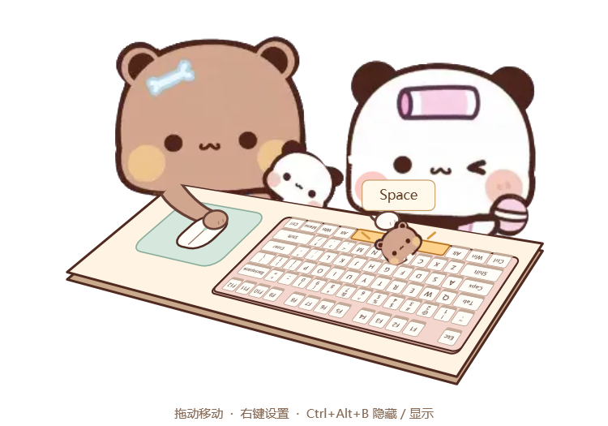

# 布布和一二双人桌宠 · BubuYierPet

离线运行的 Windows 双人桌宠：布布控制鼠标，一二握拍敲键盘。透明窗口、桌面置顶，实时反馈键鼠活动。



## 下载与启动

1. 点击 **Code → Download ZIP**，或[直接下载](https://github.com/Chenzd-code/BubuYierPet/archive/refs/heads/main.zip)。
2. **完整解压**到普通文件夹，不要在压缩包内直接运行。
3. 双击 `BubuYierPet.exe`。必须保留同目录下的 `assets` 文件夹。

仓库包含可直接运行的 EXE 和对应源码，不依赖 Python、Node.js、Codex、原版 BongoCat 或 Live2D。

运行环境为 **Windows x64 + .NET Framework 4.x/WPF**，建议 Windows 10/11 配合 .NET Framework 4.8 或更高兼容版本。当前版本未验证 macOS、Linux、Windows ARM 或所有 Windows 版本。

传给另一台电脑时，复制整个解压文件夹即可。运行所需文件如下：

```text
BubuYierPet.exe
assets/
  bubu.png
  yier.png
  paddle.png
  pet.ico
使用说明.txt
```

## 操作说明

| 功能 | 操作 |
| --- | --- |
| 移动 | 按住人物或桌面拖动 |
| 缩放 | 右键 → 显示大小；紧凑效果推荐 40%、45%、50% |
| 隐藏 / 显示 | `Ctrl + Alt + B`，或托盘菜单 |
| 暂停、置顶、退出 | 右键菜单或托盘菜单 |
| 鼠标穿透 | 右键开启，从托盘菜单关闭 |
| 找回窗口 | 托盘 → 恢复默认位置 |

新电脑首次启动使用默认尺寸，想要小尺寸请选择 **40%**。位置、大小等设置自动保存在 `%LOCALAPPDATA%\BubuYierPet\settings.txt`，不包含在下载包中。重复启动只显示已有窗口。

## 键鼠互动

- **布布**左手拿拍子，右手操作鼠标。为了符合面对面视角，鼠标在桌面平面上的前后、左右移动与真实光标方向相反；左右键点击不互换，滚轮有反馈。
- **一二**固定站位，仅有轻微呼吸；手臂伸展，拍子敲击实际触发的键帽。
- 保留 **74 个主键区按键**，包括 Esc 和 F1–F12。导航区、方向键、数字小键盘及右侧 PrtSc/ScrLk/Pause 不显示，也不会替代触发其他键帽。
- 键盘旋转 180°，**空格一侧靠近一二**。实体键帽文字随键盘转向，浮动目标键名正向显示。
- 按物理扫描码识别按键。组合键同时高亮，单个拍子敲向最后按下或重复触发的可见键。长按持续高亮；快速点击从按下起至少显示约 140 毫秒。
- 中文输入法下显示物理键位，而不是最终输入的汉字。Fn 和某些固件处理的硬件键可能不会向 Windows 发送事件。
- 两人站在桌后，下半身被桌面与键盘遮挡，手臂及操作物位于前景。

鼠标按光标在当前显示器内的位置映射，跨屏时重新计算。锁屏、安全桌面、更高权限应用和混合 DPI 多屏未作完整兼容验证。

## 从源码构建

源码位于 `src/`，使用 C# WPF、Windows Forms 托盘和 Windows 原生低级输入钩子。

在项目目录打开 PowerShell：

```powershell
.\build.ps1
.\test.ps1
```

构建脚本调用 `%WINDIR%\Microsoft.NET\Framework64\v4.0.30319\csc.exe`，会覆盖仓库根目录的 EXE。**构建前请退出这个目录中的桌宠进程。** 如果系统禁止执行 PowerShell 脚本，请根据自己的设备管理策略运行已审核的脚本；直接使用预编译 EXE 不需要运行这些脚本。

默认测试覆盖键帽映射、旋转后落点、鼠标反向、固定站位、组合键、释放和暂停等状态，不向其他应用注入输入。可选的 `--scan-test`、`--integration` 会在专用测试窗口中模拟键鼠事件，失去焦点即终止，仅用于开发调试。

生成预览图：

```powershell
Start-Process .\BubuYierPet.exe -ArgumentList '--render', 'test-results\preview' -Wait
```

## 图片与外观

`assets/bubu.png`、`assets/yier.png` 是透明角色图，`assets/paddle.png` 是活动拍面。原素材为 230×234，程序限制放大倍率以避免明显模糊；键盘、手臂、桌面和鼠标由矢量绘制。

同尺寸、同轮廓和锚点的 PNG 可以替换同名资源后重启。改变角色姿势或比例时，还需调整 `src/Scene.cs` 中的尺寸、肩部和握柄位置，否则会错位。程序不能自动适配任意角色图。修改 EXE 图标需要替换 `assets/pet.ico` 后重新构建。

## 数据与素材

程序本身不联网，不保存输入文字或按键历史，只在内存维护交互状态。窗口设置保存在本地用户目录；启动异常时可能在程序目录写入 `error.log`。

素材来源见 [SOURCES.md](SOURCES.md)。角色图片属于第三方素材，本仓库不为其声明商业授权或额外再许可。目前未附统一开源许可证；公开源码不等于授予任意用途的使用许可。
